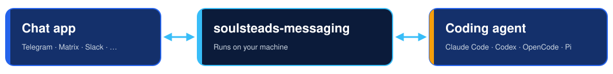

<p align="center">
  
</p>

<p align="center">
  <strong>Your coding agent. Your chat app. Easy setup. No BS.</strong><br/>
  Talk to Claude Code, Codex, OpenCode, or Pi from the messaging app you already use.
</p>

<p align="center">
  <a href="./LICENSE"></a>
  
  
  
</p>

---

## Why this bridge?

The bridge runs on your machine and connects your messages to the agent you
choose, using your own chat account and the agent you already have signed in.

<p align="center">
  
</p>

---

## What works with it?

| | Supported |
|---|---|
| 🤖 **Agents** | Claude Code, OpenAI Codex, OpenCode, and Pi |
| 💬 **Chat** | Telegram, Matrix, Mattermost, Slack, Discord, WhatsApp, and the built-in web interface |
| 🔌 **Other agents** | Any compatible [Agent Client Protocol](https://agentclientprotocol.com) (ACP) server, via a custom command |

> [!NOTE]
> **Only Telegram has a guided setup, for Claude Code or Codex on Linux.**
> Other platforms and agents need manual configuration. Connectors are included,
> not preconfigured; each needs its own credentials. This is an early `0.1.0`
> release, not a promise that every combination has been tested live.

---

## Get started

### The easy way: ask your agent

Setting this up is a conversation, not a project. Open Claude Code, Codex,
OpenCode, Pi, or any agent that can run commands, paste the prompt below, and
answer its questions. Your agent builds the bridge, writes the configuration and
installs the service; you only supply the bot token, in a private file.

```text
Set up Soulsteads Agent Messaging so I can talk to you from my chat app.

1. Clone https://github.com/soulsteads/soulsteads-agent-messaging (branch
   `release`) unless you are already inside it.
2. Read README.md and docs/SETUP.md, and use the setup-soulsteads-messaging
   skill if you have it.
3. Ask me which chat app to use (Telegram has a guided setup) and which agent
   to connect.
4. Build it, configure it, and install it as a service. Ask me before you start
   the service or change anything outside the checkout.
5. Never ask me to paste a token into chat. Tell me where to save it in a
   private file, then read it from there.
6. Finish by telling me what to send from my chat app to check it works.
```

Your agent still needs permission to run commands, and only Telegram can be set
up this way end to end. For the other platforms it follows the manual steps in
the setup guide.

### Or set it up yourself

Setup for every platform is in the **[setup guide](docs/SETUP.md)**.

| Platform | How to set it up |
|---|---|
| Telegram | [Guided setup](docs/SETUP.md#telegram) for Claude Code or Codex on Linux |
| Matrix | [Account, configuration, and user-service walkthrough](docs/MATRIX.md) |
| Mattermost | [Bot, configuration, and user-service walkthrough](docs/MATTERMOST.md) |
| Slack | [Manual setup](docs/SETUP.md#slack) |
| Discord | [Manual setup](docs/SETUP.md#discord) |
| WhatsApp | [Manual setup](docs/SETUP.md#whatsapp) |
| Web interface | [Manual setup](docs/SETUP.md#web-interface) |

Credentials go in an environment file; [`.env.example`](.env.example) lists every
variable the bridge reads.

---

## Know before you connect

> [!CAUTION]
> **Your agent keeps its machine permissions.** This bridge is not a sandbox. Use
> an account and workspace you are comfortable giving the agent access to.

| Topic | What to know |
|---|---|
| 🔓 **Privacy** | Telegram is not an end-to-end-encrypted connection to your machine. Do not send sensitive information through it. |
| ✋ **Approvals** | Prompts do not cover every tool. With Telegram interactive permissions enabled, supported shell commands can ask for approval; tools already allowed by the agent may run without another prompt. |
| 🛑 **`/cancel`** | Not a kill switch. In the known Codex cancellation case, a shell process can keep running. Unattended remote command execution is not qualified. |
| 🔐 **Matrix encryption** | Encrypted replies are not yet qualified for interoperability. |
| 🧵 **Sessions** | Chat sessions are separate from your terminal session; terminal history is not transferred. |

---

## More documentation

| Guide | Covers |
|---|---|
| [Setup guide](docs/SETUP.md) | Every platform, service commands, troubleshooting |
| [Manual user service](docs/MANUAL-SERVICE.md) | Matrix/Mattermost installation, optional Agent Home boundary, upgrades and recovery |
| [Configuration defaults](src/defaults.json) | Every available option |
| [Hindsight memory](docs/HINDSIGHT.md) | Give Claude Code, Codex, OpenCode or Pi long-term memory |

Run `./target/release/soulsteads-messaging --help` for command-line options.

---

## License

Licensed under the [Apache License 2.0](LICENSE).
